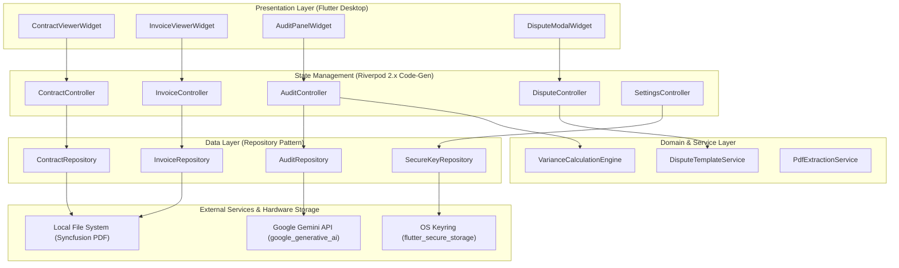
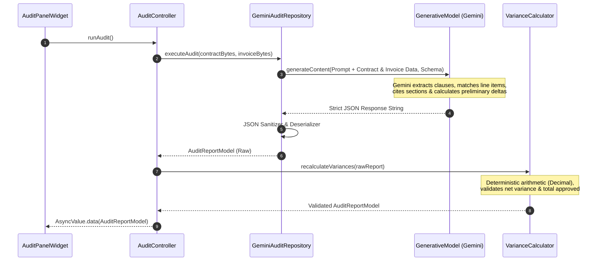
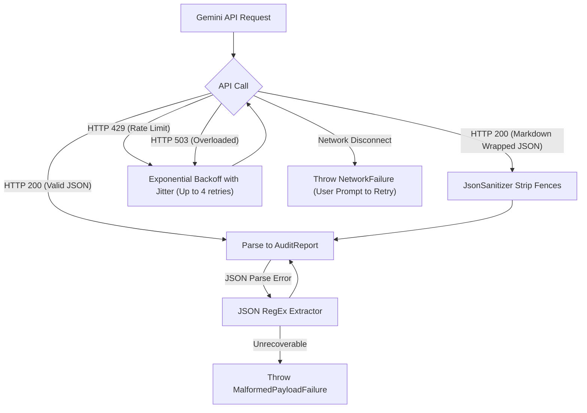

# Technical Architecture & System Design — ClairDocs

**Document Version:** 1.0.0  
**Status:** Approved Architectural Standard  
**Framework:** Flutter (Desktop Engine)  
**SDK Constraint:** Dart 3.x / Flutter 3.x  

---

## 1. Architectural Philosophy & Principles

ClairDocs is engineered as an offline-first, enterprise-grade desktop application adopting **Feature-First Architecture** combined with **Clean Architecture** boundaries.

### Core Architectural Tenets:
1. **Unidirectional Data Flow:** State propagates down through Riverpod 2.x reactive streams; user actions flow up via explicit controller methods.
2. **Immutable Domain Entities:** All domain and data models are strictly immutable, generated via `@freezed` and `json_serializable`.
3. **Strict Type Safety:** Dynamic maps (`Map<String, dynamic>`) are quarantined at the network/serialization boundary and never allowed into presentation or domain layers.
4. **Resilient AI Pipeline:** Gemini API interactions are encapsulated within repositories, protected by retry policies, rate-limit backoff, and strict JSON Schema validation.
5. **Decoupled Presentation Layer:** Widgets do not contain business logic. They consume Riverpod providers and delegate actions to controllers.

---

## 2. System Architecture Diagram



---

## 3. Feature-First Folder Structure

The project structure enforces modular isolation. Shared foundational logic resides in `core/`, while business capabilities are partitioned into self-contained feature directories.

```
lib/
├── core/
│   ├── constants/
│   │   ├── api_constants.dart             # Model identifiers, timeouts, API endpoints
│   │   ├── app_strings.dart               # Centralized localized strings & UI labels
│   │   └── legal_templates.dart           # Default dispute letter boilerplate templates
│   ├── errors/
│   │   ├── exceptions.dart                # Low-level platform & network exceptions
│   │   └── failures.dart                  # High-level typed domain failure objects
│   ├── network/
│   │   ├── retry_interceptor.dart         # Exponential backoff with jitter for HTTP/Gemini
│   │   └── connectivity_service.dart      # Network availability stream
│   ├── security/
│   │   └── secure_storage_service.dart    # Encrypted API key storage via OS credential vault
│   ├── theme/
│   │   ├── app_colors.dart                # Status colors (Match, Warning, Dispute) & palettes
│   │   ├── app_typography.dart            # Typography hierarchy & monospace font definitions
│   │   ├── app_spacing.dart               # Spacing tokens & layout grid constants
│   │   └── app_theme.dart                 # Dark and Light ThemeData definitions
│   ├── utils/
│   │   ├── currency_formatter.dart        # Deterministic currency & decimal formatting
│   │   ├── file_hasher.dart               # SHA-256 document fingerprint calculation
│   │   └── json_sanitizer.dart            # Malformed JSON recovery & markdown fence stripper
│   └── widgets/
│       ├── app_button.dart                # Enterprise standard button components
│       ├── app_text_field.dart            # Input fields with validation states
│       ├── split_pane_divider.dart        # Resizable desktop divider handle
│       └── status_badge.dart              # Color-coded severity chips (Match, Warning, Violation)
│
├── features/
│   ├── contracts/
│   │   ├── data/
│   │   │   ├── models/
│   │   │   │   ├── contract_document.dart # Freezed model for loaded contract metadata
│   │   │   │   └── contract_clause.dart   # Extracted clause data model
│   │   │   └── repositories/
│   │   │       └── contract_repository.dart
│   │   └── presentation/
│   │       ├── controllers/
│   │       │   └── contract_controller.dart # Riverpod Notifier for contract state
│   │       └── widgets/
│   │           ├── contract_pdf_viewer.dart # Syncfusion viewer wrapper
│   │           └── contract_toolbar.dart    # Page jump, zoom, clause search
│   │
│   ├── invoices/
│   │   ├── data/
│   │   │   ├── models/
│   │   │   │   ├── invoice_document.dart  # Freezed model for invoice metadata
│   │   │   │   └── invoice_line_item.dart # Parsed line item model
│   │   │   └── repositories/
│   │   │       └── invoice_repository.dart
│   │   └── presentation/
│   │       ├── controllers/
│   │       │   └── invoice_controller.dart  # Riverpod Notifier for invoice state
│   │       └── widgets/
│   │           ├── invoice_pdf_viewer.dart  # Syncfusion viewer wrapper
│   │           └── invoice_toolbar.dart     # Page navigation & line-item search
│   │
│   ├── audit/
│   │   ├── data/
│   │   │   ├── models/
│   │   │   │   ├── audit_report.dart        # Master audit payload model
│   │   │   │   ├── discrepancy_item.dart    # Individual discrepancy entity
│   │   │   │   └── discrepancy_type.dart    # Enum: rateOvercharge, policyViolation, etc.
│   │   │   └── repositories/
│   │   │       ├── audit_repository.dart    # Abstract interface
│   │   │       └── gemini_audit_repository.dart # Google Generative AI implementation
│   │   ├── domain/
│   │   │   ├── services/
│   │   │   │   └── variance_calculator.dart # Deterministic mathematical diff engine
│   │   │   └── schemas/
│   │   │       └── audit_response_schema.dart # Gemini SDK Schema definition
│   │   └── presentation/
│   │       ├── controllers/
│   │       │   ├── audit_controller.dart    # Master audit execution orchestrator
│   │       │   └── audit_filter_controller.dart # Severity & category filter state
│   │       └── widgets/
│   │           ├── audit_panel.dart         # Right-hand discrepancy drawer
│   │           ├── discrepancy_card.dart    # Individual variance item card
│   │           ├── diff_chip_row.dart       # Side-by-side expected vs invoiced chip
│   │           └── audit_summary_header.dart # Total invoiced, variance, and approved banner
│   │
│   ├── disputes/
│   │   ├── data/
│   │   │   ├── models/
│   │   │   │   └── dispute_package.dart     # Compiled dispute notice model
│   │   │   └── repositories/
│   │   │       └── dispute_repository.dart
│   │   ├── domain/
│   │   │   └── services/
│   │   │       ├── dispute_generator.dart   # Letter formatting & citation compiler
│   │   │       └── dispute_pdf_exporter.dart# Export to downloadable PDF document
│   │   └── presentation/
│   │       ├── controllers/
│   │       │   └── dispute_controller.dart  # Draft editing & export state
│   │       └── widgets/
│   │           ├── dispute_modal.dart       # Full-screen draft modal
│   │           ├── dispute_editor.dart      # Markdown/Text live editor
│   │           └── dispute_preview.dart     # Formal letterhead print preview
│   │
│   └── settings/
│       ├── data/
│       │   └── models/
│       │       └── user_settings.dart       # API key, selected model, default tolerances
│       └── presentation/
│           ├── controllers/
│           │   └── settings_controller.dart # Riverpod Notifier for configuration
│           └── widgets/
│               └── settings_dialog.dart     # API key configuration modal
│
├── app.dart                                 # Root MaterialApp widget & theme configuration
└── main.dart                                # Desktop window initialization & ProviderScope entry
```

---

## 4. State Management Strategy (Riverpod 2.x Code-Gen)

ClairDocs utilizes **Riverpod 2.x with explicit code generation** (`riverpod_annotation`, `riverpod_generator`).

### 4.1 State Flow Standards
- **Notifiers:** All mutating states derive from `@riverpod class ... extends _$Notifier` or `AutoDisposeAsyncNotifier`.
- **AsyncValue Handling:** UI widgets consume `AsyncValue<T>` using `.when()` or pattern matching, providing explicit loading, error, and data rendering branches.
- **Provider Scoping:** Core services (API keys, security vaults) are marked `@Riverpod(keepAlive: true)`, while document-specific sessions auto-dispose on close.

### 4.2 Example Controller Pattern
```dart
@riverpod
class AuditController extends _$AuditController {
  @override
  FutureOr<AuditReport?> build() {
    return null; // Initial idle state
  }

  Future<void> runAudit({
    required ContractDocument contract,
    required InvoiceDocument invoice,
  }) async {
    state = const AsyncValue.loading();
    state = await AsyncValue.guard(() async {
      final repository = ref.read(auditRepositoryProvider);
      final rawReport = await repository.executeAudit(
        contract: contract,
        invoice: invoice,
      );
      
      // Pass through deterministic client-side mathematical calculator
      final calculator = ref.read(varianceCalculatorProvider);
      return calculator.recalculateVariances(rawReport);
    });
  }
}
```

---

## 5. AI Engine Pipeline: Multi-Modal to Structured Dart Model

The AI reasoning engine bridges raw unstructured documents and typed Dart entities using the `google_generative_ai` SDK with strict JSON Schema constraints.



### 5.1 Structured Output Schema Contract
Gemini is instructed to respond strictly adhering to the defined `Schema`:

```dart
final auditResponseSchema = Schema.object(
  properties: {
    'summary': Schema.string(description: 'Executive summary of the audit findings'),
    'contractMetadata': Schema.object(properties: {
      'vendorName': Schema.string(),
      'clientName': Schema.string(),
      'effectiveDate': Schema.string(),
      'contractId': Schema.string(),
    }),
    'discrepancies': Schema.array(
      items: Schema.object(
        properties: {
          'id': Schema.string(),
          'type': Schema.string(enumValues: [
            'RATE_OVERCHARGE',
            'UNAUTHORIZED_ROLE',
            'HOURS_OVERAGE',
            'POLICY_VIOLATION',
            'MATHEMATICAL_ERROR',
            'MISSING_DISCOUNT',
            'SCOPE_DISCREPANCY'
          ]),
          'severity': Schema.string(enumValues: ['MATCH', 'WARNING', 'VIOLATION']),
          'contractCitation': Schema.object(properties: {
            'clauseNumber': Schema.string(),
            'sectionTitle': Schema.string(),
            'pageNumber': Schema.integer(),
            'quotedText': Schema.string(),
          }),
          'invoiceLineReference': Schema.object(properties: {
            'lineNumber': Schema.integer(),
            'pageNumber': Schema.integer(),
            'description': Schema.string(),
            'billedQuantity': Schema.number(),
            'billedRate': Schema.number(),
            'billedTotal': Schema.number(),
          }),
          'expectedRate': Schema.number(),
          'expectedTotal': Schema.number(),
          'varianceAmount': Schema.number(),
          'explanation': Schema.string(),
          'confidenceScore': Schema.number(),
        },
        requiredProperties: [
          'id', 'type', 'severity', 'contractCitation',
          'invoiceLineReference', 'expectedTotal', 'varianceAmount', 'explanation'
        ],
      ),
    ),
  },
  requiredProperties: ['summary', 'contractMetadata', 'discrepancies'],
);
```

---

## 6. Error Handling, Resilience & Fault Tolerance



### 6.1 Exponential Backoff & Jitter Implementation
Calls to the Gemini API are governed by a retry loop with full jitter:
$$t_{\text{sleep}} = \min(t_{\text{max}},\, t_{\text{base}} \times 2^{\text{attempt}}) \pm \text{jitter}$$
- Base backoff: 1.5 seconds.
- Max backoff: 30 seconds.
- Max retries: 4 attempts on HTTP 429 (Resource Exhausted) and HTTP 503 (Service Unavailable).

### 6.2 Malformed JSON Recovery
Large multi-page audit payloads can occasionally arrive with leading/trailing markdown fences (````json ... ````) or slight trailing commas. The `JsonSanitizer`:
1. Strips all markdown code fences and boundary whitespace.
2. Locates the outer-most balanced curly braces `{ ... }`.
3. Sanitizes unescaped control characters within string literals.
4. Deserializes into the `@freezed` typed model, throwing explicit `MalformedPayloadFailure` if structural keys are missing.

---

## 7. Storage, Security & Key Management

- **API Key Storage:** `flutter_secure_storage` interfaces directly with:
  - Windows: Windows Credential Manager (`wincred`).
  - macOS: Keychain Services.
  - Linux: Secret Service API via `libsecret`.
- **Zero In-Memory Leakage:** Keys are read into memory strictly when constructing `GenerativeModel` instances and discarded from global scope.
- **Cache Isolation:** Ingested PDF documents and audit session logs are stored within `getApplicationSupportDirectory()/clairdocs/sessions/` and encrypted or purged upon session teardown.

