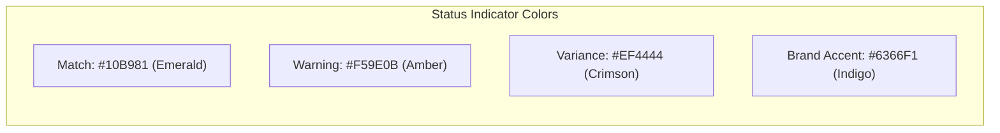

# UI/UX Specification & Design System — ClairDocs

**Document Version:** 1.0.0  
**Status:** Approved Design Specification  
**Target Form Factor:** Desktop (1920x1080 baseline, 1280x720 minimum, Ultrawide scalable)  

---

## 1. Desktop Viewport & Layout Architecture

ClairDocs is structured as an ergonomic, high-density 3-column workstation optimized for financial reconciliation.

```
+---------------------------------------------------------------------------------------------------------+
| [ClairDocs Logo]  Project: MSA_Acme_2026.pdf | Invoice_Oct2026.pdf    [Model: Gemini 3.8 Flash] [Run Audit]|
+---------------------------------------------------------------------------------------------------------+
| [Contract Toolbar: Page 3/42 | Zoom 100% | Search]  | [Invoice Toolbar: Page 1/3 | Zoom 100% | Search]   |
+------------------------------------+------------------------------------+-------------------------------+
|                                    |                                    | AUDIT DISCREPANCY PANEL       |
|                                    |                                    | ----------------------------- |
|                                    |                                    | Total Invoiced:   $142,500.00 |
|                                    |                                    | Total Contract:   $128,000.00 |
|   COLUMN 1: CONTRACT VIEWER        |   COLUMN 2: INVOICE VIEWER         | Disputed Variance: $14,500.00 |
|   (Governing Legal Agreement)      |   (Vendor Billed Line Items)       | Status: 3 Violations, 1 Warn  |
|                                    |                                    | ----------------------------- |
|   * Master Services Agreement      |   * Invoice # INV-2026-889         | [Card: Rate Overcharge]       |
|   * Section 4.2 Rate Schedule      |   * Line 4: Lead Cloud Arch        |   Invoiced: $220/hr           |
|     "Lead Architect: $175/hr"      |     Billed: 160 hrs @ $220/hr      |   Contract: $175/hr           |
|                                    |                                    |   Variance: +$7,200.00        |
|                                    |                                    |   [View Clause] [View Line]   |
|                                    |                                    | ----------------------------- |
|                                    |                                    | [Card: Out-of-Scope Expense]  |
|                                    |                                    |   Line 8: Luxury Ground Trans |
|                                    |                                    |   Variance: +$1,250.00        |
|                                    |                                    | ----------------------------- |
|                                    |                                    | [ GENERATE DISPUTE NOTICE ]   |
+------------------------------------+------------------------------------+-------------------------------+
| Sync Scroll: [ON] | Highlighting: [ACTIVE] | SHA-256 Verified: [OK]    | Status: Idle / Ready          |
+---------------------------------------------------------------------------------------------------------+
```

### 1.1 Column Sizing & Split-View Physics
The workspace utilizes resizable split-view containers with draggable vertical dividers:

- **Column 1 — Contract Viewer (Left):**
  - Default width: `35%` of viewport width.
  - Min width: `25%` (approx. 320px).
  - Max width: `50%`.
- **Column 2 — Invoice Viewer (Middle):**
  - Default width: `35%` of viewport width.
  - Min width: `25%`.
  - Max width: `50%`.
- **Column 3 — Audit Discrepancy Panel (Right):**
  - Default width: `30%` of viewport width.
  - Min width: `20%` (approx. 280px).
  - Max width: `45%`.
  - **Collapsible:** Clicking the collapse icon in the header collapses Column 3 to `0%`, dedicating 100% of the viewport to side-by-side document comparison.
- **Divider Handles (`SplitPaneDivider`):**
  - Width: `4px` resting, expanding to `8px` with accent highlight on hover.
  - Cursor: `SystemMouseCursors.resizeColumn`.
  - Double-click action: Resets columns to default `35% / 35% / 30%` ratio.

---

## 2. Enterprise Design System

The visual language balances high-density data legibility with an executive aesthetic. Dark mode serves as the primary default for long-session audit work.

### 2.1 Color Palette



| Token Name | Dark Mode Value | Light Mode Value | Functional Purpose |
| :--- | :--- | :--- | :--- |
| `surfaceBackground` | `#0B0F19` (Near Black) | `#F8FAFC` (Off-white Slate) | Root app window background |
| `surfacePrimary` | `#111827` (Deep Slate) | `#FFFFFF` (Pure White) | Viewer canvas, cards, panels |
| `surfaceSecondary` | `#1F2937` (Cool Gray) | `#F1F5F9` (Light Slate) | Toolbars, divider bars, table headers |
| `surfaceElevated` | `#374151` (Medium Slate) | `#E2E8F0` (Border Slate) | Hover states, popovers, dropdowns |
| `borderSubtle` | `#2D3748` (Slate Border) | `#E2E8F0` (Muted Gray) | Panel borders, card outlines |
| `brandAccent` | `#6366F1` (Indigo 500) | `#4F46E5` (Indigo 600) | Primary CTA buttons, focus indicators |
| `textPrimary` | `#F9FAFB` (High White) | `#0F172A` (Deep Navy) | Headings, primary metrics, active text |
| `textSecondary` | `#9CA3AF` (Muted Gray) | `#475569` (Slate Gray) | Clause text, secondary metadata |
| `statusMatch` | `#10B981` (Emerald 500) | `#059669` (Emerald 600) | Contract match, compliant rates |
| `statusMatchBg` | `rgba(16, 185, 129, 0.12)` | `rgba(5, 150, 105, 0.10)`| Background badge for match |
| `statusWarning` | `#F59E0B` (Amber 500) | `#D97706` (Amber 600) | Ambiguous clause, unverified receipts |
| `statusWarningBg` | `rgba(245, 158, 11, 0.12)` | `rgba(217, 119, 6, 0.10)` | Background badge for warning |
| `statusDispute` | `#EF4444` (Crimson 500) | `#DC2626` (Red 600) | Overbilling, contract violation |
| `statusDisputeBg` | `rgba(239, 68, 68, 0.15)` | `rgba(220, 38, 38, 0.10)` | Background badge for dispute |

### 2.2 Typography Scale

The font stack uses **Inter** (or native system sans-serif: Segoe UI on Windows, SF Pro on macOS) for interface elements and **JetBrains Mono** for monetary figures, line codes, and contractual citations.

| Role | Font Family | Size | Weight | Line Height | Tracking |
| :--- | :--- | :--- | :--- | :--- | :--- |
| `displayLarge` | Inter | 24px | Bold (700) | 32px | -0.5px |
| `titleMedium` | Inter | 16px | SemiBold (600) | 22px | -0.2px |
| `bodyMedium` | Inter | 13px | Regular (400) | 18px | 0.0px |
| `bodySmall` | Inter | 11px | Regular (400) | 15px | +0.1px |
| `monoMetric` | JetBrains Mono | 18px | Bold (700) | 24px | -0.3px |
| `monoValue` | JetBrains Mono | 13px | Medium (500) | 18px | 0.0px |
| `monoCitation` | JetBrains Mono | 11px | Regular (400) | 14px | +0.2px |

### 2.3 Spacing & Elevation Tokens
- `spacingXXS`: 2px
- `spacingXS`: 4px
- `spacingSM`: 8px
- `spacingMD`: 16px
- `spacingLG`: 24px
- `spacingXL`: 32px
- `borderRadiusSM`: 4px (Buttons, badges)
- `borderRadiusMD`: 8px (Cards, input fields)
- `borderRadiusLG`: 12px (Modals, split panels)

---

## 3. Core Component Breakdown

### 3.1 Document Toolbars (`DocumentToolbarWidget`)
Integrated above each PDF viewer:
- **File Badge:** Document name, page count badge, SHA-256 fingerprint tooltip.
- **Page Controller:** Jump-to-page numerical field (`[ 3 ] / 42`), previous/next arrow buttons.
- **Zoom Controls:** `-`, Zoom Level dropdown (`Fit Width`, `Fit Page`, `50%`, `100%`, `150%`, `200%`), `+`.
- **Search Field:** In-document string search with hit counter (`Hit 2 of 7`) and jump arrows.
- **Sync Scroll Toggle:** Button with link icon to lock/unlock scroll positions across the contract and invoice.

### 3.2 Audit Summary Metrics Banner (`AuditSummaryHeader`)
Positioned at the top of Column 3:
- **Metric Tile 1:** Invoiced Total (e.g., `\$142,500.00`).
- **Metric Tile 2:** Contract Approved Total (e.g., `\$128,000.00`).
- **Metric Tile 3:** Disputed Variance Total highlighted in Crimson (e.g., `+\$14,500.00`).
- **Severity Counter:** Pill badges showing count of Violations (Crimson) and Warnings (Amber).

### 3.3 Discrepancy Card (`DiscrepancyCardWidget`)
Expandable list items detailing individual issues:
- **Card Header:**
  - Severity Icon & Type Badge (`RATE_OVERCHARGE`, `OUT_OF_SCOPE`).
  - Line Item Reference (e.g., `Invoice Line #4: Lead Cloud Architect`).
  - Net Variance Pill (`+\$7,200.00`).
- **Card Body (Expanded):**
  - **Side-by-Side Diff Chips:**
    ```
    [ Invoiced: 160 hrs @ $220.00 = $35,200.00 ]   vs   [ Contract: 160 hrs @ $175.00 = $28,000.00 ]
    -------------------------------------------------------------------------------------------------
    Net Discrepancy: +$7,200.00 (+25.7% over agreed rate)
    ```
  - **Contract Citation Box:**
    - Clause number & title: `Clause 4.2: Approved Rate Card (Schedule B)`.
    - Page number jump link: `[Jump to Page 18]`.
    - Quoted clause excerpt: *"Lead Cloud Architect rate is capped at \$175/hour inclusive of local transit."*
  - **AI Reasoning Explanation:**
    - Concise explanation generated by Gemini outlining the contractual basis for dispute.
  - **Action Controls:**
    - `[Accept Discrepancy]` (Includes in dispute notice).
    - `[Dismiss/Waive]` (Marks variance as an approved business exception).

### 3.4 Dispute Draft Modal (`DisputeModalWidget`)
A focused desktop modal window launched when the user clicks **Generate Dispute Notice**:
- **Left Panel (Settings & Controls):**
  - Dispute Template Selector (`Standard Formal`, `Strict Legal Reservation`, `Friendly Administrative`).
  - Recipient Vendor Contact Fields (Name, Title, Email).
  - Payment Terms Deadline (e.g., `10 Business Days`).
  - Undisputed Amount to Release (Pre-calculated: `Total - Disputed`).
- **Right Panel (Interactive Document Preview):**
  - Rich markdown and formatted legal letter rendering.
  - Formatted Discrepancy Schedule table embedded in letter.
  - Live editing capability directly within the preview pane.
- **Footer Actions:**
  - `[Copy to Clipboard]` (Formatted plaintext for email).
  - `[Export Markdown (.md)]`.
  - `[Export Formal PDF (.pdf)]` (Formatted with corporate letterhead).
  - `[Cancel / Close]`.

