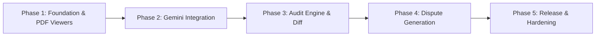

# Product Requirements Document (PRD) — ClairDocs

**Product Name:** ClairDocs  
**Document Version:** 1.0.0  
**Status:** Approved / Architecture Blueprint  
**Target Platform:** Desktop (Windows, macOS, Linux)  
**Target Release:** v1.0.0-MVP  

---

## 1. Executive Overview & Problem Statement

### 1.1 Executive Summary
**ClairDocs** is an autonomous desktop workstation built for enterprise finance operations, procurement officers, and vendor compliance teams. It solves the critical, expensive problem of invoice leakage by cross-examining multi-page vendor invoices against governing Master Services Agreements (MSAs), Statements of Work (SOWs), Rate Cards, and Service Level Agreements (SLAs).

Powered by Google's multi-modal Gemini AI engine (`google_generative_ai`), Riverpod 2.x state management, and high-performance dual-document rendering via `syncfusion_flutter_pdfviewer`, ClairDocs transforms a manual, multi-day invoice reconciliation process into an automated, auditable, sub-minute workflow.

### 1.2 Problem Statement
In enterprise procurement and accounts payable (AP):
- **Contract Complexity:** Modern corporate service contracts span 20–100+ pages of legal provisions, tiered hourly rate cards, expense reimbursement caps, overtime thresholds, currency clauses, and milestone deliverables.
- **Invoice Volume & Fragmentation:** Invoices arrive as unstructured or semi-structured multi-page PDFs with dozens of line items, disguised service descriptions, and obscure cost codes.
- **Manual Auditing Bottleneck:** Human AP auditors can inspect only a small fraction (often < 10%) of line items against underlying contracts. The rest are rubber-stamped.
- **Financial Leakage:** Enterprises lose an estimated 3% to 7% of total procurement spend to invoice billing errors, unauthorized rate hikes, phantom hours, unapplied volume discounts, and non-compliant expense markups.
- **Friction in Dispute Resolution:** Drafting formal dispute notices requires cross-referencing contract clause numbers, page citations, line-item identifiers, and exact dollar variances. Consequently, disputed amounts are frequently written off due to the friction of compiling evidence.

### 1.3 Value Proposition
ClairDocs delivers:
1. **Side-by-Side Dual Ingestion:** Simultaneous visual inspection of contract and invoice with synchronized viewer controls.
2. **Autonomous Multi-Modal Audit:** Instant extraction and automated cross-referencing of contract terms against invoice line items using Gemini structured reasoning.
3. **Deterministic Mathematical Variance:** Zero-hallucination discrepancy calculation combining AI clause matching with client-side exact arithmetic.
4. **Instant Legal Dispute Generation:** One-click generation of legally formatted vendor dispute letters citing exact contractual clauses, invoice lines, and computed withhold amounts.
5. **Data Sovereignty & Local Execution:** Single-tenant desktop architecture where documents never leave the local machine except via direct, encrypted calls to Google AI Studio with user-controlled API keys.

---

## 2. Core User Personas

| Persona | Role & Context | Primary Pain Points | Key ClairDocs Workflows |
| :--- | :--- | :--- | :--- |
| **Elena Vance** *Finance Operations Lead* | Handles high-volume monthly vendor billing reconciliation ($50M+ annual spend across IT, consulting, and logistics). | Overwhelmed by volume; cannot manually cross-check hundreds of contractor timesheets against contract rate matrices. | Ingests monthly invoice batch; reviews auto-detected discrepancies; verifies computed variances; triggers dispute notice. |
| **Marcus Thorne** *Procurement & Vendor Manager* | Negotiates enterprise MSAs/SOWs and monitors supplier contract compliance. | Vendors billing at out-of-band rates or ignoring milestone discount tiers; lack of audit trail when negotiating renewal terms. | Inspects clause-to-line-item mapping; checks vendor billing fidelity score; exports comprehensive discrepancy audit history. |
| **Samantha Reed** *Compliance & Internal Auditor* | Ensures corporate governance, SOX compliance, and transparent audit trails for external financial audits. | Difficulty tracing why disputed amounts were paid or withheld; lack of standardized evidentiary documentation. | Reviews cryptographic file hash matching, structured audit logs, timestamped dispute correspondence, and clause citations. |

---

## 3. Functional Requirements

### 3.1 Document Ingestion & Dual Viewing (FR-1)
- **FR-1.1:** System MUST accept PDF files via native OS drag-and-drop or file system pickers for both the **Governing Contract** (left pane) and the **Target Invoice** (middle pane).
- **FR-1.2:** System MUST compute and display the SHA-256 cryptographic hash of ingested files to guarantee evidentiary immutability.
- **FR-1.3:** The PDF viewers MUST support smooth scrolling, multi-page continuous layout, pinch-to-zoom, page navigation jumps, and zoom-to-fit/zoom-to-width controls.
- **FR-1.4:** System MUST allow independent or synchronized scrolling between the contract and invoice documents.
- **FR-1.5:** System MUST extract text and structural layout data from ingested PDFs for multi-modal payload compilation.

### 3.2 Automated Clause & Line-Item Extraction (FR-2)
- **FR-2.1:** From the **Contract**, the system MUST extract:
  - Vendor and Client legal identities.
  - Effective dates and expiration/renewal milestones.
  - Billable role rate cards (e.g., Senior Architect @ \$185/hr, QA Engineer @ \$95/hr).
  - Expense policies (e.g., travel caps, per-diem rules, zero markup on third-party software).
  - Payment and discount terms (e.g., 2% 10 Net 30, volume rebates).
  - SLA penalty triggers and milestone acceptance criteria.
- **FR-2.2:** From the **Invoice**, the system MUST extract:
  - Invoice metadata (Invoice #, Date, Billing Period, Due Date, PO Reference).
  - Vendor billing entity and remit-to information.
  - Individual line items (Description, Resource Name, Role, Quantity/Hours, Unit Rate, Total Amount).
  - Additional fees, expenses, taxes, and claimed discounts.
  - Invoice stated total vs. sum of itemized lines.

### 3.3 Gemini AI Structured Cross-Audit (FR-3)
- **FR-3.1:** The AI engine MUST execute an audit by combining multi-modal contract content and invoice content under a strict JSON Schema response contract.
- **FR-3.2:** The audit engine MUST detect the following discrepancy types:
  - `RATE_OVERCHARGE`: Invoiced hourly or unit rate exceeds the contractually agreed rate card.
  - `UNAUTHORIZED_ROLE`: Billing for a job title or role not authorized in the SOW/rate card.
  - `HOURS_OVERAGE`: Billed hours exceed the agreed milestone cap or weekly limits without prior written authorization.
  - `POLICY_VIOLATION`: Expense reimbursement claims violating contract policy (e.g., alcohol, business-class travel, unreceipted expenses).
  - `MATHEMATICAL_ERROR`: Line item `quantity * unit_rate != line_total`, or lines do not sum to invoice total.
  - `MISSING_DISCOUNT`: Failure to apply agreed volume, early-payment, or tier-based discounts.
  - `SCOPE_DISCREPANCY`: Services described fall outside the defined deliverables in the SOW.
- **FR-3.3:** For every detected discrepancy, the AI engine MUST return:
  - Exact Contract Clause Citation (Clause number, Section title, Page number, Quoted text snippet).
  - Exact Invoice Line Reference (Line number, Item description, Page number, Billed amount).
  - Discrepancy category and confidence score (0.0 to 1.0).
  - Natural language explanation of the contractual violation.

### 3.4 Mathematical Variance Calculation Engine (FR-4)
- **FR-4.1:** All variance amounts MUST be calculated using client-side deterministic high-precision arithmetic (`Decimal` / fixed-point), not floating-point arithmetic.
- **FR-4.2:** System MUST calculate:
  - Expected Amount (per contract terms).
  - Invoiced Amount (as billed).
  - Net Variance Dollar Amount (`Invoiced - Expected`).
  - Variance Percentage (`(Net Variance / Expected) * 100`).
  - Recommended Approved Amount for payment.
  - Total Disputed Withhold Amount across all flagged lines.
- **FR-4.3:** System MUST categorize each audit item into one of three visual severity states:
  - `MATCH` (Green): Full compliance within tolerance thresholds.
  - `WARNING` (Amber): Minor ambiguity, missing supporting receipts, or potential tier discrepancies requiring human review.
  - `VIOLATION` (Crimson): Clear contractual breach, overcharge, or unapproved rate.

### 3.5 Dispute Notice Generation & Export (FR-5)
- **FR-5.1:** System MUST generate a legally formal, professional **Notice of Billing Dispute** document with one click.
- **FR-5.2:** Dispute notice MUST include:
  - Formal letterhead formatting (Vendor details, Client details, Date, Registered PO reference).
  - Executive summary of the invoice audit and net payment status (Total Invoiced, Total Withheld, Total Approved).
  - Itemized Discrepancy Schedule table with column citations (Invoice Line, Contract Clause, Billed Rate, Agreed Rate, Variance).
  - Formal legal reservation of rights clause and payment rectification deadline (e.g., 10 business days).
  - Remittance statement specifying the partial undisputed payment being released.
- **FR-5.3:** System MUST allow inline editing of the generated dispute draft prior to final export.
- **FR-5.4:** System MUST provide multi-format export capabilities:
  - Formal PDF generation with corporate letterhead.
  - Plain Text / Markdown export for direct email transmission.
  - One-click copy formatted text to system clipboard.

---

## 4. Non-Functional Requirements

### 4.1 Desktop Responsiveness & Performance (NFR-1)
- **NFR-1.1:** System MUST support target operating systems:
  - Windows 10/11 (x86_64)
  - macOS 12+ (Apple Silicon & Intel x86_64)
  - Linux (Ubuntu 22.04+, Fedora 38+, Debian 12+)
- **NFR-1.2:** The desktop UI MUST maintain a smooth 60 FPS refresh rate during simultaneous rendering and scrolling of two 100+ page PDF documents.
- **NFR-1.3:** Memory usage MUST not exceed 450 MB RAM under standard operational loads with dual active PDFs.
- **NFR-1.4:** Cold start launch time MUST be under 2.5 seconds on SSD-equipped workstations.

### 4.2 Security, Privacy & Local Sovereignty (NFR-2)
- **NFR-2.1:** Google AI Studio API Keys MUST be stored locally using platform-native hardware/OS credential vaults (`flutter_secure_storage`: Windows Credential Manager, macOS Keychain, Linux Secret Service). API keys MUST NEVER be written to unencrypted local files or logs.
- **NFR-2.2:** Document payloads MUST be transmitted directly from the client desktop to the official Google Gemini API endpoint over TLS 1.3. No intermediary proxy or third-party telemetry server may intercept document data.
- **NFR-2.3:** The application MUST operate with zero external telemetry or tracking SDKs to satisfy enterprise legal and NDA restrictions.
- **NFR-2.4:** Cached document thumbnails and parsed tokens MUST be stored in the OS-designated app data sandbox with appropriate access permissions.

### 4.3 Offline Fallback & Cache Integrity (NFR-3)
- **NFR-3.1:** Previous audit reports, dispute letters, and document metadata MUST be fully browsable and exportable without an active internet connection.
- **NFR-3.2:** If an active Gemini API call is interrupted by network failure, the application MUST preserve the session state, persist temporary extraction caches, and provide a resumption retry button.
- **NFR-3.3:** The local persistence layer MUST maintain atomic write guarantees to prevent database or cache corruption upon sudden app termination.

---

## 5. Success Metrics & KPIs

| Metric | Baseline (Manual Process) | Target (ClairDocs v1.0) |
| :--- | :--- | :--- |
| **Audit Time per Invoice** | 45 – 90 minutes per 10-page invoice | < 45 seconds |
| **Line-Item Audit Coverage** | 5% – 15% sampled | 100% comprehensive |
| **Overbilling Detection Rate** | ~35% of subtle rate variations caught | > 98% contractual variances caught |
| **Dispute Package Creation Time** | 30 – 60 minutes drafting & citing | < 15 seconds (instant compilation) |
| **AP Auditor Ergonomic Strain** | High (switching between PDF reader, Excel, and Word) | Low (unified 3-column synchronized workstation) |

---

## 6. Project Scope & Roadmap

### 6.1 In Scope for v1.0.0
- Dual PDF Viewer with zoom, sync scroll, and page jump.
- Direct Gemini 3.8 Flash API integration via `google_generative_ai`.
- Strict JSON Schema-based audit extraction.
- Deterministic variance calculation engine.
- 3-column responsive desktop layout with collapsible audit drawer.
- Dispute letter generator with PDF, Markdown, and clipboard export.
- OS-native secure credential storage for Gemini API key.
- Dark & Light enterprise themes.

### 6.2 Out of Scope for v1.0.0 (Future Horizons)
- Direct two-way integration with ERP suites (SAP S/4HANA, NetSuite, Workday).
- Multi-user real-time collaboration server.
- Automated payment gateway execution (ACH/Wire release).
- Optical Character Recognition (OCR) for scanned, non-vector, handwritten receipts (future via Gemini Vision or dedicated OCR plugins).

